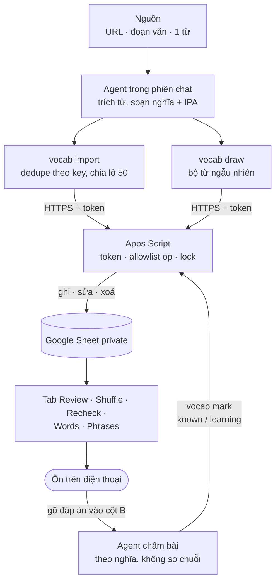

# vocab-cli

Lưu từ/cụm từ tiếng Anh gặp khi đọc docs vào một Google Sheet **private**, có phân loại, IPA,
nghĩa theo ngữ cảnh và câu ví dụ. Không UI, không dependency bắt buộc, không API key LLM —
phần "hiểu nghĩa" do agent trong phiên chat làm.

- Sheet là nơi bạn **xem lại** (điện thoại/web), có các tab `Review` · `Shuffle` · `Recheck` ·
  `Words` · `Phrases`.
- `bin/vocab` chỉ là HTTP client ~200 dòng, stdlib, không giữ secret trong repo.
  (`certifi` là dependency **tuỳ chọn**, chỉ cần khi OpenSSL của Python không có CA path.)
- Nguyên tắc: **agent lo phần hiểu, Sheet lo phần nhớ, CLI chỉ là ống dẫn.**

## Vì sao có repo này

Từ mới gặp thì nhiều nhưng chúng rơi rụng: ghi vào Notes thì không mở lại, chép vào Anki thì
công nhập nghĩa/IPA/ví dụ lớn hơn giá trị học, còn dán cả đoạn vào chat để hỏi nghĩa thì lần sau
vẫn phải hỏi lại từ đầu.

| Nỗi đau | Cách repo này xử lý |
|---|---|
| Nhập liệu thủ công (nghĩa, IPA, ví dụ) | Agent trong phiên chat tự trích từ và soạn hết; nó đã đọc nguồn nên nghĩa đúng ngữ cảnh |
| Ghi chú rải rác, không ôn lại được | Một Google Sheet private là nơi lưu duy nhất; các tab ôn tập mở được trên điện thoại |
| Hạ tầng nặng cho một việc nhỏ | CLI Python stdlib + Apps Script: không DB, không OAuth, không API key LLM, không server |

## Cách hoạt động



Gặp lại từ cũ thì không tạo dòng mới: chỉ `lookup_count + 1`, nên Sheet tự cho biết từ nào đáng
ôn lại. Cột A của `Shuffle` là **value** do `vocab draw` ghi, không phải công thức — gõ đáp án
ở cột B hay chấm bài đều không làm từ xê dịch.

## Bắt đầu

1. Tạo Google Sheet → **Restricted**. Trong Sheet: **Extensions → Apps Script** → dán
   [`apps-script/Code.gs`](apps-script/Code.gs) → đặt Script Property `TOKEN` → **Deploy → Web
   app** (Execute as *Me*, access *Anyone*).
2. Tạo `~/.config/vocab-cli/config.json` (600) chứa `endpoint` + `token`, thêm `bin/` vào PATH,
   chạy `vocab ping`.
3. Tạo các tab ôn tập theo [docs/sheet.md](docs/sheet.md), rồi bắt đầu lưu từ.

Chi tiết từng bước, bảo mật, troubleshoot: [docs/setup.md](docs/setup.md).

## Dùng

**Cách chính: nói với agent, không gõ lệnh.**

> "lưu từ vựng từ `https://academy.claude.com/courses/introduction-to-evals`"
> "lưu các từ mới trong đoạn này: …"
> "lưu `accuracy floor`"  ← từ trần, agent sẽ hỏi 1 câu để chọn nghĩa
> "điền inbox"            ← từ bạn đã gõ sẵn vào tab `inbox`
> "trộn bài"              ← rút bộ từ mới vào tab `Shuffle`
> "chấm bài"              ← chấm đáp án bạn gõ trong `Shuffle`/`Recheck`

Agent đọc nguồn, tự trích từ/cụm từ đáng lưu, tự viết nghĩa + IPA + câu ví dụ, rồi gọi
`vocab import` một lần và trả về bảng:

```
term             loại       nghĩa                              kết quả
accuracy floor   phrase     ngưỡng sàn độ chính xác tối thiểu   mới
drift            tech_term  lệch chất lượng theo thời gian      đã có (gặp lần 3)

12 mới · 3 đã có · 0 lỗi
```

Bạn **không** cần cung cấp nghĩa, phiên âm hay ví dụ. Không giới hạn số từ mỗi lượt.

| Việc | Câu nói | Chi tiết |
|---|---|---|
| Lưu từ từ nguồn | "lưu từ vựng từ …" | [docs/workflows.md](docs/workflows.md#lưu-từ-mới) |
| Điền từ bạn gõ trong Sheet | "điền inbox" | [docs/workflows.md](docs/workflows.md#điền-inbox) |
| Rút bộ từ ôn | "trộn bài" | [docs/workflows.md](docs/workflows.md#trộn-bài) |
| Chấm đáp án | "chấm bài" | [docs/workflows.md](docs/workflows.md#chấm-bài) |
| Sửa nghĩa/gloss | "sửa nghĩa của X" | [docs/commands.md](docs/commands.md) |

## Lệnh

```bash
vocab import --file rows.json        # ghi hàng loạt (đường dẫn chính)
vocab check "drift" "accuracy floor"
vocab list --status new --domain evals
vocab mark drift --status learning
vocab sheet --name Shuffle           # đọc đáp án cột B
vocab draw [--count 20]              # ghi bộ từ vào Shuffle!A
vocab update --file glosses.json     # sửa field dòng đã có
vocab clear-inbox shovel --confirm   # dọn tab inbox
vocab delete "block a merge"         # xoá hẳn (không hoàn tác)
vocab ping
```

Danh sách đầy đủ, ý nghĩa từng lệnh và exit code: [docs/commands.md](docs/commands.md).

## Kiểm tra

```bash
python3 tests/test_cli.py    # CLI + gate + chunking (no network, API faked)
node tests/test_gas.js       # chạy Code.gs thật với SpreadsheetApp giả lập
```

Sửa `Code.gs` thì bắt buộc chạy `node tests/test_gas.js`, và phải **Deploy → New version** thì
endpoint live mới đổi.

## Tài liệu

- [docs/setup.md](docs/setup.md) — cài đặt, cấu hình, bảo mật, troubleshoot, self-check
- [docs/sheet.md](docs/sheet.md) — tab ôn tập + công thức, cột `terms`, tab `glossary`
- [docs/workflows.md](docs/workflows.md) — lưu từ, inbox, trộn bài, chấm bài
- [docs/commands.md](docs/commands.md) — toàn bộ lệnh + exit code
- `.opencode/skills/` — luật chi tiết cho agent: `vocab-capture`, `vocab-draw`, `vocab-grade`
